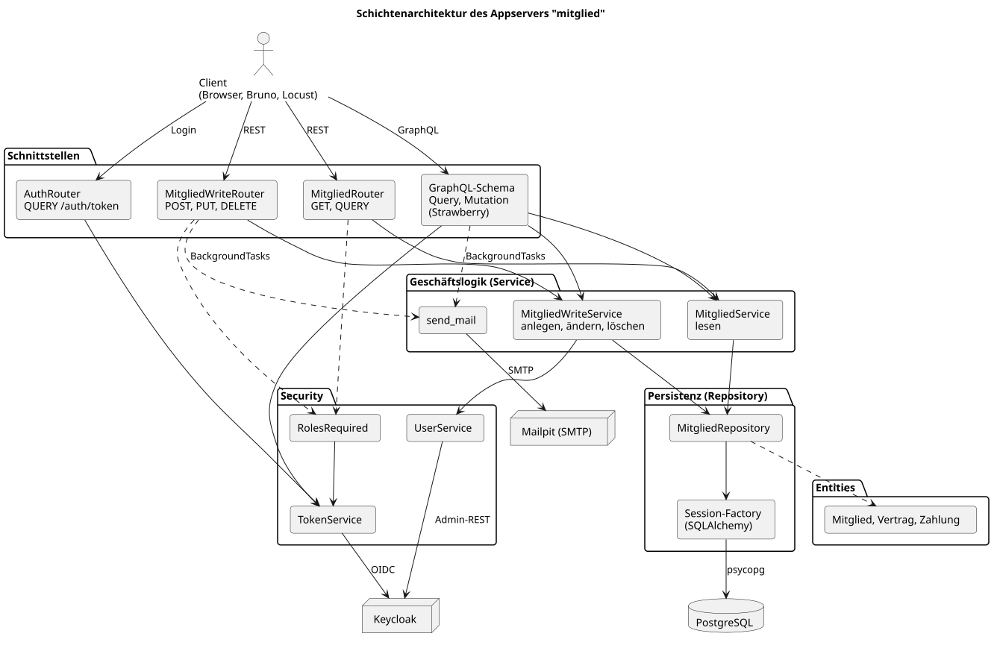
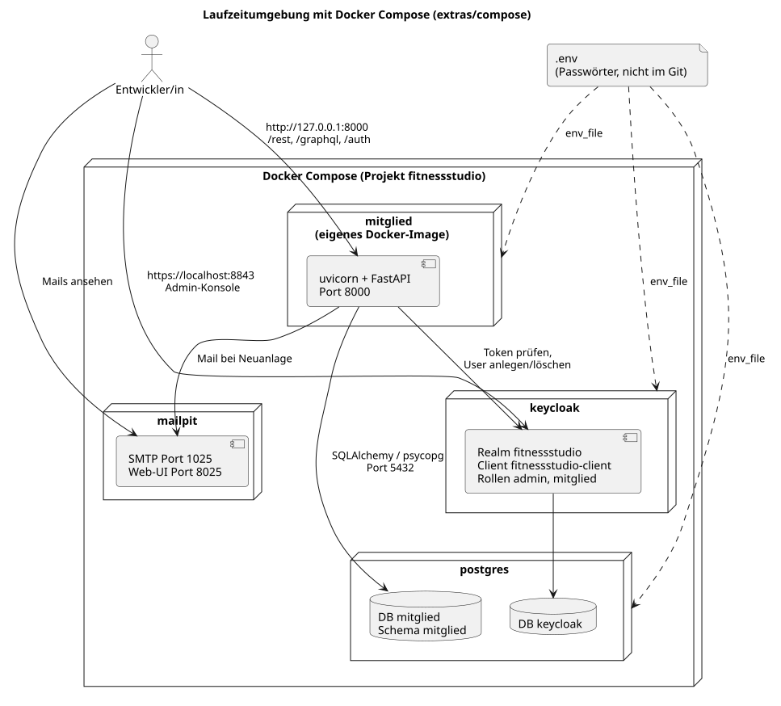
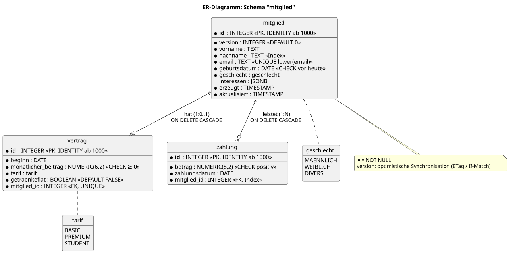
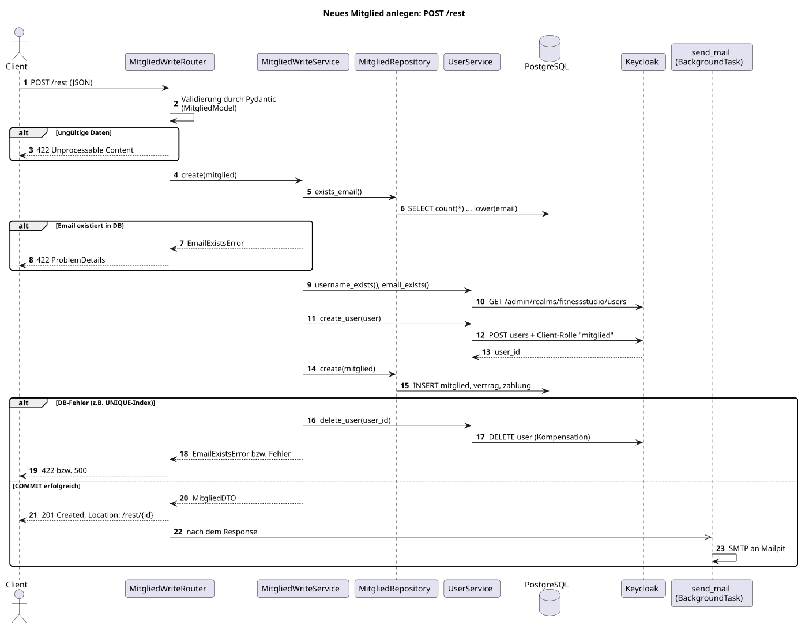
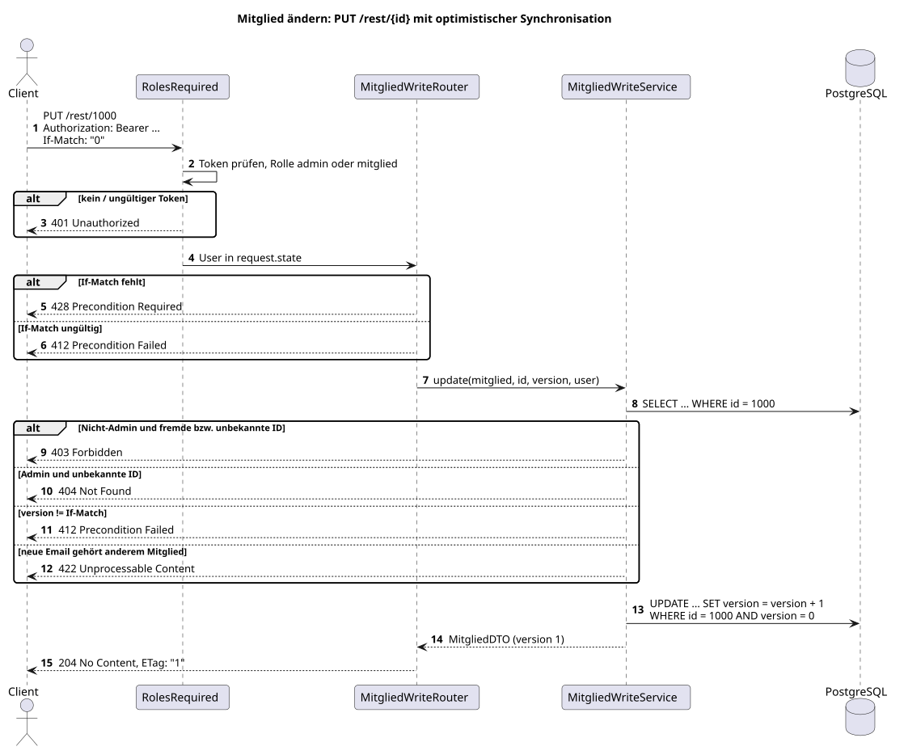

# Architektur

Die ausführliche Beschreibung steht in `docs/fitnessstudio.adoc`. Die Diagramme
werden mit PlantUML aus `docs/diagramme/*.puml` erzeugt.

## Schichten

Router (REST) bzw. GraphQL-Schema → Service (Geschäftslogik) → Repository
(SQLAlchemy) → PostgreSQL. Die Security-Schicht prüft Token und Rollen mit Keycloak.

## Laufzeitumgebung

## Datenmodell

## Neues Mitglied anlegen

## Mitglied ändern

