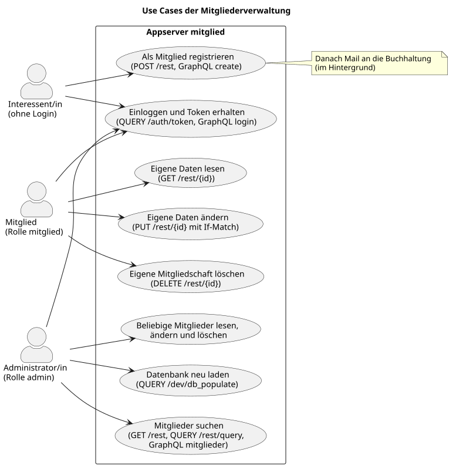

# Fitnessstudio – Appserver `mitglied`

Der Appserver verwaltet die Mitglieder eines Fitnessstudios mit ihrem Vertrag und
ihren Zahlungen. Er bietet eine REST- und eine GraphQL-Schnittstelle, speichert die
Daten in PostgreSQL und sichert die Zugriffe mit Keycloak (OIDC, OAuth 2) ab.

Entwickelt von **Esma Ak** und **Eyübhan Yörümez** im Rahmen der Vorlesung
_Software Engineering_ an der Hochschule Karlsruhe (Aufgabe 1).

## Dokumentation

| Dokument | Inhalt |
| -------- | ------ |
| [Architektur](architektur.md) | Use Cases, Schichten, Laufzeitumgebung, Datenmodell, Abläufe |
| API-Referenz | aus den Docstrings im Quellcode erzeugt (Menü links) |
| `docs/fitnessstudio.adoc` | ausführliche Projektdokumentation mit AsciiDoctor und PlantUML |
| `README.md` | Installation, Start, Tests und Werkzeuge |

## Use Cases

